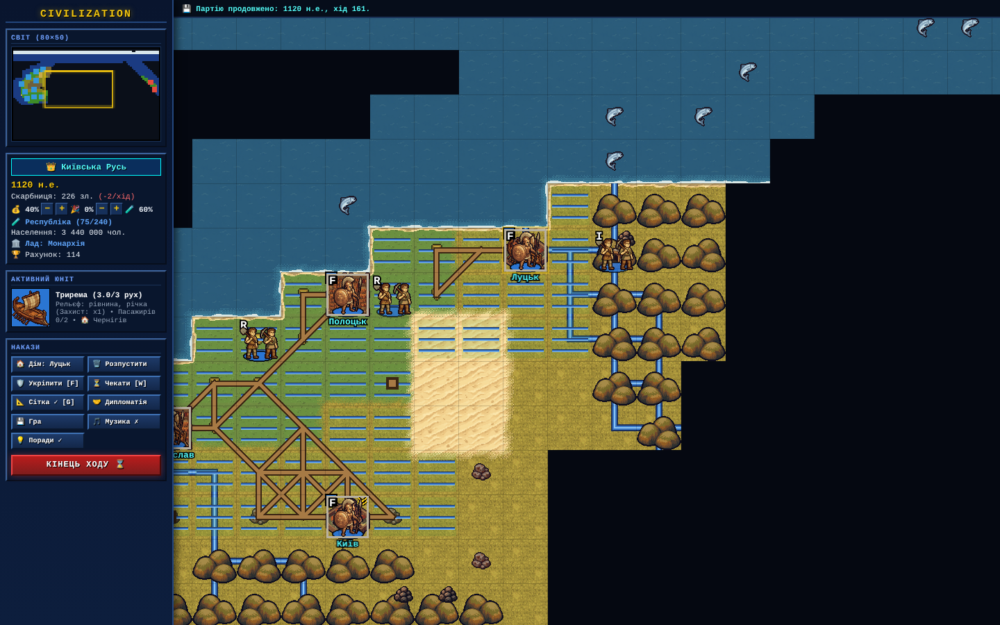
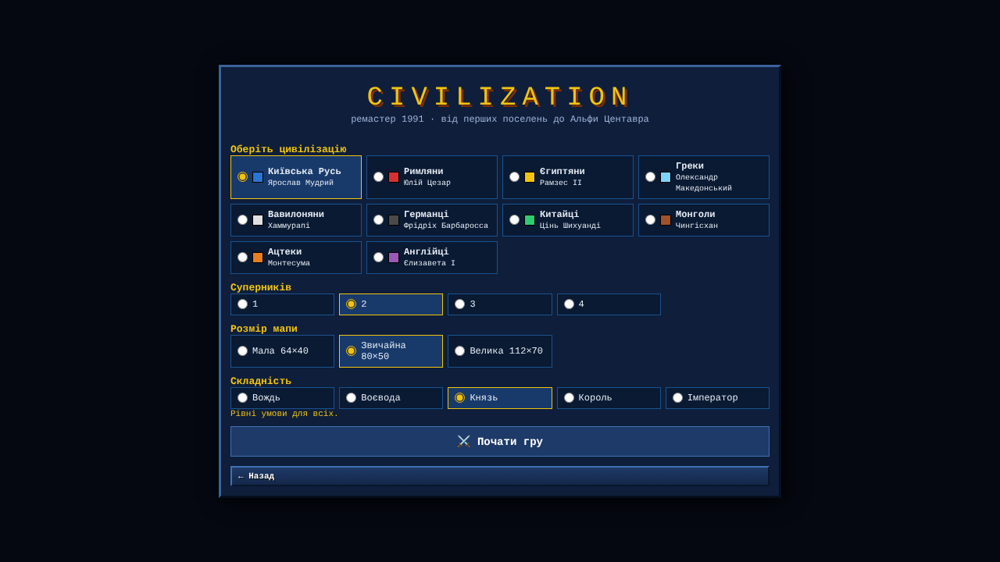
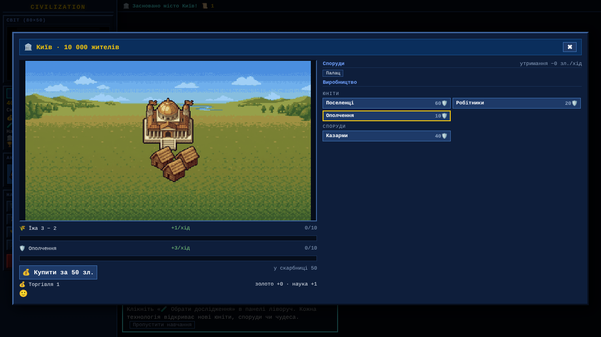

# Civilization — a 1991 remaster for the browser

**▶ Play: [https://olexiytanchik.github.io/civ1-remaster/](https://olexiytanchik.github.io/civ1-remaster/)** · [Українською нижче](#civilization--ремастер-1991-у-браузері)

A web remake of Sid Meier's Civilization (1991), the classic turn-based strategy game. You lead one band of settlers in 4000 BC to a starship bound for Alpha Centauri. The game keeps the original rules and adds pixel-art graphics, AI rivals, diplomacy, naval and air warfare, and the space race. It runs in the browser with nothing to install — on desktop or phone, in English or Ukrainian.



| New game | City screen |
|---|---|
|  |  |

## Features

- **From antiquity to the stars:** 99 technologies across seven eras, 99 unit types (including civilization-specific units and great people), 82 city improvements and 60 Wonders of the World. Each one unlocks only when its technology is discovered.
- **Civ 1 city management:** food, production and trade from worked tiles, happiness and civil disorder, corruption, pollution and trade routes. Each city has a panorama that grows with its buildings.
- **A map shaped by your work:** roads, railroads, irrigation, mines and terraforming. Fog of war, tribal huts, barbarians and random events.
- **AI rivals:** 16 civilizations, each with its own leader, personality, unique units and buildings. The AI researches, builds, scouts the seas, ferries invasions, flies air strikes and decides when to go to war.
- **Diplomacy:** leader meetings, war and peace, tribute and tech trading. Embassies, diplomats and spies can steal, sabotage and bribe, and leaders remember broken treaties.
- **6 governments**, from Despotism to Democracy and Fundamentalism, with revolutions and anarchy.
- **Space race and endgame:** win by spaceship, by conquest or by score in 2100. Past games go into a Hall of Fame.
- **Newcomer-friendly:** a step-by-step tutorial for the first turns, advisor tips, an `F1` help screen, and a «⚡ Quick start» that jumps straight to 1000 AD with a growing empire.
- **Stats and achievements:** charts of score, cities, techs and army over the whole game, the world's top 5 cities, demographics and a chronicle. There are 23 achievements (some hidden), and the end screen shows your civilization's story with a world map.
- **Sound and music** are synthesized live with Web Audio in a DOS-chiptune style.
- **Saves:** an autosave every turn plus 3 manual slots in the browser. Three map sizes, four world types, scenarios and five difficulty levels.
- **Two languages and mobile:** English and Ukrainian (🇬🇧/🇺🇦 switch in the menu; the default follows the browser language), and a phone layout with a slide-out panel and pinch zoom.

## Tech stack

- **TypeScript** (strict) + **Vite 6** + **PixiJS 8**. There is no UI framework: the interface is plain HTML templates styled as a DOS-era UI.
- **Art pipeline:** the pixel sprites were generated with Gemini from a sprite manifest (`assets_src/sprites.json`). A Python pipeline (`tools/process-sprites.py`) then slices the grids, removes backgrounds, downscales, quantizes to a palette, outlines and packs everything into an atlas. Terrain is baked onto canvas chunks with dithered biomes, coastlines and rivers.
- **Localization:** the code is written in Ukrainian; `src/i18n/` adds English without touching the game logic — entity names are swapped at startup, and a DOM translator renders every interface string and game message from a dictionary with `{0}` templates.
- **AI-assisted development:** the code was written together with Claude Code. The roadmap, project map and design notes are in [`docs/ai/`](docs/ai/).

## Architecture

- `src/core/` holds the DOM-free game logic: `World` (state, cross-system rules, turn processing, save/load), `CityLogic`, `Diplomacy`, `AiController` + `FleetAi`, the game data and the map generator.
- `src/render/` holds the PixiJS layers (terrain, improvements, cities, units, fog) and the sprite atlas.
- `src/ui/` holds the sidebar, dialogs, main menu, tutorial, statistics, achievements and audio; `src/i18n/` holds the languages.
- Because the logic is independent from rendering, balance is tested by running full AI-only games of hundreds of turns in Node.

Details (in Ukrainian): [`docs/ai/PROJECT_MAP.md`](docs/ai/PROJECT_MAP.md) (files and rules) and [`docs/ai/ROADMAP.md`](docs/ai/ROADMAP.md) (stages and simulation results).

## Running locally

```bash
npm install
npm run dev       # http://localhost:3000
npm run build     # static build in dist/
npm run preview   # serve the build
```

## Deployment

The build uses relative paths (`base: './'`), so `dist/` works from any folder on any static host. The included workflow [`.github/workflows/deploy.yml`](.github/workflows/deploy.yml) builds and publishes the game to GitHub Pages on every push to `main`. For Netlify, Vercel or Cloudflare Pages: build command `npm run build`, output directory `dist`.

## Legal

This is a non-commercial fan project. Civilization is a trademark of its respective owners, and this project is not affiliated with them.

---

# Civilization — ремастер 1991 у браузері

**▶ Грати: [https://olexiytanchik.github.io/civ1-remaster/](https://olexiytanchik.github.io/civ1-remaster/)** · [English above](#civilization--a-1991-remaster-for-the-browser)

Вебверсія класичної покрокової стратегії Sid Meier's Civilization (1991): від одного поселенця 4000 р. до н.е. до польоту на Альфу Центавра. Правила оригіналу, піксельна графіка, AI-суперники, дипломатія, флот, авіація й космічна гонка. Без встановлення, просто в браузері.


| Нова гра | Екран міста |
|---|---|
|  |  |

## Що є в грі

- **Від Античності до космосу:** 99 технологій у семи епохах, 99 видів юнітів (з унікальними для кожної цивілізації й великими людьми), 82 споруди і 60 чудес світу. Кожна технологія відкриває щось нове, і нічого не з'являється «наперед».
- **Міста за правилами Civ 1:** їжа, щити й торгівля з клітинок, щастя й безлад, корупція, забруднення, торгові маршрути. Панорама міста змінюється з кожною спорудою.
- **Мапа, що змінюється від праці:** дороги, залізниця, зрошення, шахти й перетворення рельєфу. Туман війни, хатки племен, варвари.
- **AI-суперники:** 16 цивілізацій із власним характером, унікальними юнітами й спорудами. AI досліджує, будує, розвідує море, висаджує десанти, водить авіацію і вирішує, коли воювати.
- **Дипломатія:** зустрічі з лідерами, мир і війна, данина, обмін технологіями. Є посольства, дипломати й шпигуни (крадіжка, саботаж, підкуп міст), а напад під час миру лідери пам'ятають як зраду.
- **6 державних устроїв**, від Деспотизму до Демократії й Фундаменталізму, з революцією та анархією.
- **Космічна гонка й кінець гри:** перемога кораблем, завоюванням або рахунком у 2100 р. Є «Зал слави».
- **Для новачків:** покрокове навчання на перших ходах, поради радника, довідка `F1`, а «⚡ Швидкий старт» одразу переносить у 1000 н.е. з кількома містами.
- **Статистика й досягнення:** графіки рахунку, міст, технологій і армії за всю партію, топ-5 міст світу, демографія, хроніка. 23 досягнення (є приховані), а в кінці гри — «Історія цивілізації» з мапою світу.
- **Звук і музика** синтезуються в браузері (Web Audio) у дусі DOS-chiptune.
- **Збереження:** автоматичне після кожного ходу плюс 3 слоти в браузері. Три розміри мапи, чотири типи світу, сценарії й п'ять рівнів складності.
- **Дві мови й телефон:** українська та англійська (перемикач 🇺🇦/🇬🇧 у меню), мобільна верстка з висувною панеллю й зумом двома пальцями.

## Технології

- **TypeScript** (strict) + **Vite 6** + **PixiJS 8**, без UI-фреймворку: інтерфейс складається з HTML-рядків і CSS у стилі DOS.
- **Графіка:** піксельні спрайти згенеровано моделлю Gemini за маніфестом (`assets_src/sprites.json`). Власний конвеєр на Python (`tools/process-sprites.py`) нарізає сітки, вирізає фон, зменшує, зводить до палітри, обводить контуром і пакує в атлас. Рельєф «запікається» на полотна шматками 16×16 клітинок: дизеринг біомів, береги, річки.
- **Розробка в парі з AI:** код написано разом з Claude Code. Дорожня карта, мапа проєкту й журнал рішень лежать у [`docs/ai/`](docs/ai/).

## Архітектура

- `src/core/` — чиста логіка гри без DOM: `World` (стан і правила між системами, кінець ходу, збереження), `CityLogic`, `Diplomacy`, `AiController` + `FleetAi`, дані (`constants.ts`), генератор мапи.
- `src/render/` — шари PixiJS: рельєф, покращення, міста, юніти, туман; атлас спрайтів.
- `src/ui/` — бічна панель, діалоги (місто, наука, дипломатія, космос), головне меню, навчання, звук.
- Логіка не залежить від рендера, тож AI-партії на сотні ходів ганяються в Node для перевірки балансу.

Детальніше: [`docs/ai/PROJECT_MAP.md`](docs/ai/PROJECT_MAP.md) (файли й правила) і [`docs/ai/ROADMAP.md`](docs/ai/ROADMAP.md) (етапи й результати симуляцій).

## Запуск

```bash
npm install
npm run dev       # http://localhost:3000
npm run build     # статична збірка в dist/
npm run preview   # перегляд збірки
```

## Деплой

Збірка використовує відносні шляхи (`base: './'`), тож `dist/` працює з будь-якого каталогу будь-якого статичного хостингу. Воркфлоу [`.github/workflows/deploy.yml`](.github/workflows/deploy.yml) збирає й публікує гру на GitHub Pages після кожного пушу в `main`. Для Netlify, Vercel чи Cloudflare Pages: команда збірки `npm run build`, каталог `dist`.

## Правові примітки

Некомерційний фанатський проєкт. Civilization — торгова марка її правовласників, і цей проєкт з ними не пов'язаний.
